<!-- animated contribution graph: real data, boxes reveal cell by cell
     (regenerated daily by .github/workflows/update-profile-art.yml) -->

<h3><code>granton@github ~ $ ./contributions.sh</code></h3>

 
 

<!-- ascii portrait (left) + streak/numbers card (right). both svgs are
     840x880 so equal widths give equal heights. -->

<h3><code>granton@github ~ $ whoami</code></h3>

<table>
<tr>
<td valign="top"></td>
<td valign="top"></td>
</tr>
</table>

 
 

<h3><code>granton@github ~ $ ./links.sh</code></h3>

<b>I am Granton</b>

  <code>Python</code> &nbsp;•&nbsp; <code>TypeScript</code>

 
 

<!-- REPOS:START -->
- [**loghound**](https://github.com/GRANTON-ui/loghound) — AI-powered log diagnostics engine that analyzes server logs, stack traces, and infrastructure failures to identify root causes and recommend fixes. `TypeScript` ⭐ 15
- [**mockflow**](https://github.com/GRANTON-ui/mockflow) — Next-gen zero-config mock API, real-time streaming engine (WebSocket/SSE) & synthetic data studio with embedded dark-mode UI. `TypeScript` ⭐ 2
<!-- REPOS:END -->

 

