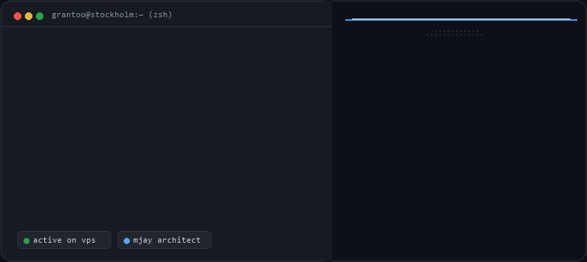

<div align="center">
  
</div>

<br/>

### ⚡ About Me
I'm **Granton**, an autonomous systems architect and open-source engineer based in **Stockholm, Sweden 🇸🇪**. Focused on distributed multi-agent intelligence, real-time audio/voice pipelines, and resilient cloud architectures.

```yaml
identity: Granton Mokua
location: Stockholm, Sweden 🇸🇪
flagship: M.Jay Sovereign Autonomous Multi-Agent OS
passions: ["AI Swarms", "Hedge Architectures", "High-Performance Backends"]
status: "Building next-generation sovereign AI ●"
```

#### 🛠️ Tech & Tooling
`TypeScript` `Python` `FastAPI` `Node.js` `React` `Next.js` `Docker` `Oracle Cloud (OCI)` `Tailwind CSS`

---

#### 🌟 Featured Open-Source Repositories

<!-- REPOS:START -->
- [**loghound**](https://github.com/GRANTON-ui/loghound) — AI-powered log diagnostics engine that analyzes server logs, stack traces, and infrastructure failures to identify root causes and recommend fixes. `TypeScript` ⭐ 15
- [**mockflow**](https://github.com/GRANTON-ui/mockflow) — Next-gen zero-config mock API, real-time streaming engine (WebSocket/SSE) & synthetic data studio with embedded dark-mode UI. `TypeScript` ⭐ 2
<!-- REPOS:END -->

---

<div align="center">
  <sub>📫 Contact: <a href="mailto:grantonmokua@gmail.com">grantonmokua@gmail.com</a> • Built with autonomous precision</sub>
</div>
