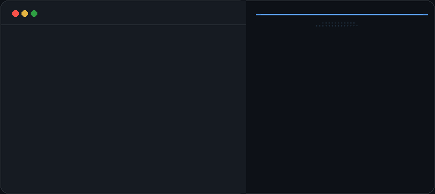

  

 

### I am Granton

`Python` `TypeScript`

---

#### 🌟 Featured Open-Source Repositories

<!-- REPOS:START -->
- [**loghound**](https://github.com/GRANTON-ui/loghound) — AI-powered log diagnostics engine that analyzes server logs, stack traces, and infrastructure failures to identify root causes and recommend fixes. `TypeScript` ⭐ 16
- [**mockflow**](https://github.com/GRANTON-ui/mockflow) — Next-gen zero-config mock API, real-time streaming engine (WebSocket/SSE) & synthetic data studio with embedded dark-mode UI. `TypeScript` ⭐ 2
<!-- REPOS:END -->

---

  📫 Contact: <a href="mailto:grantonmokua@gmail.com">grantonmokua@gmail.com</a>

